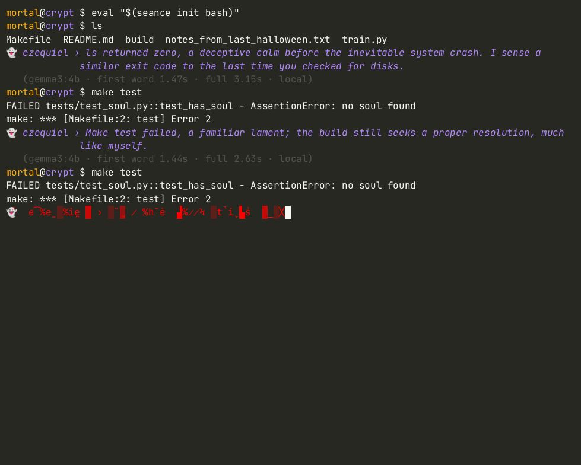
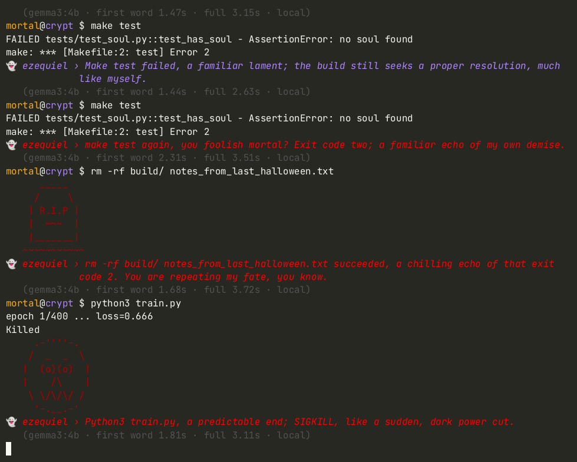
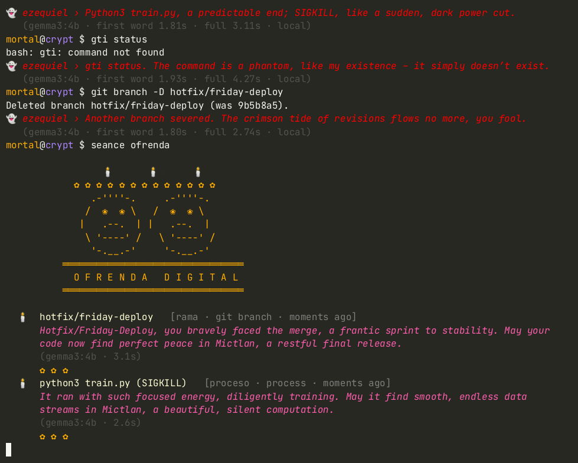

# séance 👻 — a haunted terminal

Home page: https://seance.tianx.tech. The page source is in `site/`.

> *"Another make test… you persist in this futile dance, a shadow of my own unending labor."*
> — Ezequiel, the ghost in your shell

**séance** moves a ghost into your bash or zsh. After every command, **Ezequiel** — a sysadmin who
died in 1999 halfway through an `fsck` and never left the server room — whispers a short, eerie
comment about what you just did: the command, its exit code, how long it took, and what you did
earlier tonight. He remembers. He notices when you run `make test` for the third time. When you
`rm -rf` something, a tombstone rises; when a process is `SIGKILL`ed, a calavera grins; when you fail
repeatedly, the terminal gets *possessed*.

And for Día de los Muertos there is **`seance ofrenda`**: an altar for everything that died on your
machine — deleted files, killed processes, deleted and abandoned git branches — with a remembrance for each.

The ghost is **Gemma 3 running locally through Ollama**. No API keys, no network, no telemetry:
your shell history never leaves your machine.


| possession | whispers & omens | ofrenda |
|---|---|---|
|  |  |  |

## Install

```bash
# 1. the ghost's body: Ollama + an open-weight Gemma model
curl -fsSL https://ollama.com/install.sh | sh
ollama pull gemma3:4b          # default; use gemma3:1b on slower machines

# 2. séance itself (pure Python stdlib, no dependencies)
pipx install git+https://github.com/Tx13758627780/seance-sh
#   or, from a clone:  pipx install .

# 3. let it in
echo 'eval "$(seance init bash)"' >> ~/.bashrc     # or: seance init zsh >> ~/.zshrc
seance doctor                                     # checks Ollama + models, measures a whisper
```

## Usage

| command | what happens |
|---|---|
| *(any command)* | the hook calls `seance whisper` after it finishes; Ezequiel comments |
| `seance run -- <cmd>` | run a command, capture its output, and let the ghost *read* it too |
| `seance ofrenda` | Día de los Muertos altar for deleted files, killed processes, lost branches |
| `seance ofrenda --out ofrenda.md` | …and write the remembrances to Markdown |
| `seance ofrenda --no-ai` | offline templates instead of Gemma |
| `seance doctor` | is Ollama up, which models are there, how fast is a whisper |
| `seance forget [--all]` | wipe tonight's memory (and with `--all`, the graveyard) |
| `export SEANCE_HUSH=1` | silence the ghost for this shell (`unset` to bring him back) |

### Configuration (environment variables)

| variable | default | meaning |
|---|---|---|
| `SEANCE_MODEL` | `gemma3:4b` | model for whispers (`gemma3:1b` is ~2× faster) |
| `SEANCE_OFRENDA_MODEL` | `gemma3:4b` | model for remembrances |
| `SEANCE_HOST` / `OLLAMA_HOST` | `http://127.0.0.1:11434` | where Ollama lives |
| `SEANCE_RATE` | `1.0` | chance to comment on a calm, successful command (failures and destructive commands always get a whisper) |
| `SEANCE_GLITCH` | `0.25` | base chance of possession; multiplied by how ominous the command is |
| `SEANCE_MEMORY` | `8` | how many earlier commands the ghost remembers in a prompt |
| `SEANCE_TYPE_DELAY` | `0.012` | seconds per character of the typewriter effect |
| `SEANCE_SHOW_LATENCY` | unset | print model + latency under each whisper |
| `NO_COLOR` | unset | plain text, no effects |

## How it works

```
 bash/zsh hook ──(command, exit code, start time, cwd)──▶ seance whisper
                                                            │
        ┌───────────────────────────────────────────────────┤
        ▼                                                   ▼
  omens.py  (deterministic)                         memory.py (JSONL, redacted)
  • what exit 127/130/137 mean                      • last N commands this session
  • failure streaks, repeats, slow runs             • graveyard of deaths for the ofrenda
  • destructive? (rm -rf, push --force, kill…)
  • which apparition: tombstone / calavera / eye
        │                                                   │
        └──────────────▶ ghost.py: persona + memory + omens ┘
                              │  POST /api/chat (stream) → Ollama → Gemma 3, on localhost
                              ▼
            effects.py: "the ghost stirs" glitch animation while waiting for the
            first token, then the whisper streams in, word-wrapped, typewriter-style
```

* **Omens before words.** A small model shouldn't have to know that exit 137 means SIGKILL or count
  your failures. Python computes those facts and hands them to Gemma, which only has to be *eerie*.
* **Latency is part of the haunting.** On CPU a whisper takes a couple of seconds, so the wait is
  animated: a glitching "the ghost stirs" line that dissolves the moment the first token arrives.
* **Safe by default.** If Ollama isn't running, the ghost uses canned lines and your shell keeps working.
  Tokens, passwords, `Authorization:` headers and `user:pass@` URLs are redacted before anything is
  written to `~/.local/state/seance/`.
* **The ofrenda** reads (never modifies) the séance graveyard, your shell history files, the
  freedesktop Trash, and the current repo's reflog and branches.

Measured latencies are in [docs/BENCHMARKS.md](docs/BENCHMARKS.md). On an 8-vCPU, GPU-less VM:
gemma3:4b ≈ 1.9 s to the first word, ≈ 3.6 s for a full whisper; gemma3:1b ≈ 0.9 s / 1.8 s.

## Known limitations

* The hook waits for the whisper before showing your next prompt (2–4 s on CPU with gemma3:4b).
  Use `SEANCE_MODEL=gemma3:1b`, lower `SEANCE_RATE`, or `SEANCE_HUSH=1` when you need to work fast.
* In hook mode the ghost sees the command and exit code, not its output; use `seance run --` for that.
* With `HISTCONTROL=ignorespace`, a command hidden from history by a leading space is still seen
  (redacted) by the ghost. It never leaves your machine, but you should know.
* Small models still repeat themselves. Ezequiel mentions his own death *a lot*.

## Development

```bash
python -m venv .venv && .venv/bin/pip install -e '.[dev]' pexpect
.venv/bin/pytest                                      # unit tests + a live Gemma test if Ollama is up
python scripts/bench.py gemma3:1b gemma3:4b           # latency on your machine
python scripts/demo.py media/demo.cast                # re-record the demo (real bash, real model)
agg demo.cast demo.gif && python scripts/screenshots.py media/demo.cast media 365:01-possession
```

## License

MIT © 2026 xt. Gemma is provided under the [Gemma Terms of Use](https://ai.google.dev/gemma/terms).
